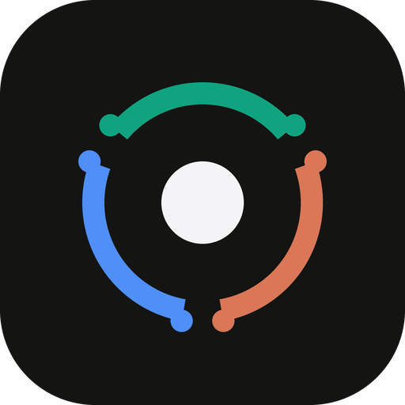

<p align="center">
  
</p>

<h1 align="center">MoE Deck</h1>

<p align="center">
  <a href="https://github.com/olivermikkola/moedeck-community/actions/workflows/ci.yml"></a>
  <a href="LICENSE.md"></a>
  
</p>

**MoE Deck** is a single-binary Rust daemon gateway for steering multiple local AI coding harnesses—**Claude Code (`claude`)**, **Antigravity (`agy`)**, **Codex (`codex`)**, **OpenCode (`opencode`)**, and **Keel (`keel`)**—from one cockpit, on your phone, desktop, or terminal (`moedeck tui`). Keel is not publicly released yet; the other four use their public CLIs.

Switch between agent conversations, create a Git worktree for a task, respond to supported native approval requests, or hand context to a different harness. A Git worktree separates working files and branches; it is not a security sandbox.

- **[Vision (`VISION.md`)](VISION.md):** Why MoE Deck exists, the "One Captain, Multi-Harness" philosophy, and why terminal-on-a-phone wrappers fail.
- **[Architecture (`ARCHITECTURE.md`)](ARCHITECTURE.md):** Lock-free JSONL/SQLite tailing, bounded seek parsing for 100 MB+ agent logs, cross-harness context handoff, and security boundaries.
- **[Competitive Landscape (`COMPETITIVE_LANDSCAPE.md`)](COMPETITIVE_LANDSCAPE.md):** How MoE Deck compares to Claude Code Remote Control (`claude.ai/code`), Cursor Background Agents, Devin 2.0, OpenAI Codex Web, AionUi, and OpenCode Manager.

## Quickstart

Requirements: a Rust toolchain (stable via [rustup](https://rustup.rs)) on Linux or macOS. The harness CLIs (`claude`, `codex`, `opencode`, …) are only needed if you want MoE Deck to actually *drive* them—MoE Deck still discovers and renders their existing sessions without them.

```bash
git clone https://github.com/olivermikkola/moedeck-community.git
cd moedeck-community

# Build release binary
cargo build --release

# Run it in the background as you (systemd on Linux, launchd on macOS),
# copied to ~/.local/bin/moedeck, then print the phone pairing link + passcode
./target/release/moedeck install

# In a terminal: opens the TUI (and starts the daemon if it isn't running)
moedeck

# Attach a terminal cockpit to an already-running daemon
moedeck tui
```

Run by a service manager (no TTY), `moedeck` stays daemon-only and listens on
`0.0.0.0:7770` by default; override with `MOEDECK_PORT`. Open the cockpit at
`http://<host>:7770`. On a phone in landscape it renders as a native-feeling
PWA; on the same machine at `http://localhost:7770`. Existing sessions are discovered automatically from `~/.claude/projects/`, `~/.gemini/antigravity-cli/brain/`, `~/.codex/sessions/`, `~/.local/share/opencode/opencode.db`, and `~/.keel/sessions/`—no agent gets locked or interrupted.

> 💡 Expose it to your phone with **Tailscale**: MagicDNS `.ts.net` hosts are allow-listed. Every device still logs in with the passcode (`moedeck pair` shows it and a one-tap pairing link).

### Claude app fallback

Send `/rc` in MoE Deck's phone composer, or open the harness selector → **Claude app ·
Remote Control**. MoE Deck starts a native Claude Remote Control terminal for the
chosen project and account, shows its connection link and native questions, and
keeps it running when the page closes. Use the Claude app's Code tab to connect.
See [the Remote Control guide](docs/claude-remote-control.md) for permissions,
Stop, and verification limits.

### Terminal cockpit (`moedeck tui`)

The daemon is the backend; the PWA is the phone/desktop client. The same
daemon also has a terminal cockpit:

```bash
moedeck tui
```

`moedeck tui` attaches to an existing daemon on `MOEDECK_PORT`, or starts one if the
port is not already serving MoE Deck. It authenticates automatically through the
user-only `~/.config/moedeck/tui.token` written by the daemon; if that token is
stale it falls back to `MOEDECK_PASSCODE`, `auth.json`, or an in-TUI passcode
prompt. Set `MOEDECK_TUI_NO_SPAWN=1` to require an already-running daemon.

| Key | Action |
|---|---|
| `j` / `k`, `↑` / `↓` | move between threads |
| `/` | search threads live |
| `f` | cycle harness filter (All / Claude / AGY / Codex / OpenCode / Keel) |
| `Enter` | open thread and focus the composer |
| `i` | focus the composer |
| `n` | new thread with the selected harness/model |
| `h` / `m` | cycle harness / model |
| `M` | harness & model picker (shows provider URLs) |
| `Ctrl-P` or `:` | command palette |
| `a` | approvals (`y` allow once, `!` always, `n` deny) |
| `s` | cycle safety mode (safe / standard / yolo) |
| `x` | stop the current turn |
| `r` | refresh threads and conversation |
| `?` | key help |
| `q` / `Ctrl-C` | quit |

The TUI polls the same HTTP API as the PWA, so threads, approvals, models and
safety modes stay in sync between the terminal and the phone. Quitting the TUI
leaves the daemon (and the PWA) running.

### Configuration

All configuration is environment- or config-file-based; no flags required.

| Knob | Default | What it does |
|---|---|---|
| `MOEDECK_PORT` | `7770` | HTTP port the daemon binds on `0.0.0.0` |
| `MOEDECK_PASSCODE` | unset | Cockpit passcode. Overrides `auth.json`. **Every** non-public request needs a logged-in session cookie — tailnet/loopback peers included |
| `~/.config/moedeck/auth.json` | auto-created | `{ "passcode": … }` — a random passcode is generated on first start. It can be changed (`moedeck passcode <new>`) but not removed |
| `~/.config/moedeck/profiles.json` | auto-created | Extra per-harness account profiles; their isolated homes live in `~/.config/moedeck/profiles/<id>/` |

> **Bind notice:** MoE Deck listens on `0.0.0.0` so your phone can reach it. A passcode is always required, but access to the cockpit can allow commands to run as your user. Restrict network access to trusted devices; use an encrypted connection such as Tailscale rather than exposing the HTTP port to the public internet.

`moedeck --help` lists the options; `moedeck --version` prints the daemon version; `moedeck login <profile-id>` signs an extra account profile in.

### Background service

`moedeck install` writes a user service with *your* paths (no root needed):
`~/.config/systemd/user/moedeck.service` on Linux,
`~/Library/LaunchAgents/moedeck.plist` on macOS. It copies the binary to
`~/.local/bin/moedeck`, keeps your shell's `PATH` so the service finds the same
`claude`/`codex`/`agy` you can run, and carries `MOEDECK_PORT`/`MOEDECK_CONFIG_DIR`
if you set them. The passcode never goes into the service file.
`moedeck install --dry-run` prints the file without touching anything;
`moedeck uninstall` removes the service and keeps your chats and settings.
On Linux, `loginctl enable-linger $USER` keeps MoE Deck running after you log out.

---

## Key Capabilities

1. **Unified Multi-Harness Composer & Cross-Harness Handoff:**
   - Switch between **Claude Code**, **Antigravity (`agy`)**, **Codex**, and **OpenCode** via the bottom Harness Pill—even mid-thread, with automatic conversation context handoff.
   - Select harness-specific models (`Opus 5.5`, `Sonnet 4.5`, `Gemini 4 Argon`, `GPT-5.6 Sol`, `Kimi K3.1 Pro`, `GLM 5.3 Flash`, `MiMo v2.6 Pro`, `DeepSeek V4 Flash`) and reasoning effort (`Low`, `Medium`, `High`, `XHigh`, `Max`).
2. **Instant Thread Bouncing, Search & Visual Identity:**
   - Multiplex panes: each conversation is a terminal-style pane. Wide screens tile them (click to focus, `⤢`/Alt+Z to zoom, drag a pane title to swap, Alt+0–9 to jump); phones show one pane and swipe sideways between them. A tmux-style bar lists the windows and opens Quick settings (`⚙`).
   - 1-Tap Quick-Flip pill in the top-right header returns to the previous conversation.
   - Slide-out drawer with instant keyword search across titles, projects, and previews + harness filter chips (`All`, `Claude`, `AGY`, `Codex`, `OpenCode`).
   - Signature harness accents:
     - **Claude Code:** Warm Terracotta (`#D97757`)
     - **Antigravity (`agy`):** Electric Blue (`#4F8FF7`)
     - **Codex (`codex`):** Emerald Green (`#10A37F`)
     - **OpenCode (`opencode`):** Amethyst Purple (`#A855F7`)
3. **Live On-Disk Session Discovery Across All Harnesses:**
   - Automatically tails existing sessions in `~/.claude/projects/`, `~/.gemini/antigravity-cli/brain/`, `~/.codex/sessions/YYYY/MM/DD/rollout-*.jsonl`, and `~/.local/share/opencode/opencode.db` (SQLite) without locking or interrupting active terminal/desktop sessions.
4. **Mobile Code Ergonomics (`@file` Autocomplete + Git Diff Inspector):**
   - **`@file` Autocomplete:** Type `@` in the mobile composer to fuzzy-search and insert file paths from the active project repository (`GET /api/files`).
   - **Workspace & Git Diff Sheet:** Tap the header title (or type `/diff` or `/workdir`) to view current git branch, modified files, syntax-colored `git diff` (`GET /api/git-diff`), GitHub PR links, pin/rename threads, or switch between `~/Projects/*` directories.
5. **Git Worktrees, PR/CI Actions, Second-Opinion Arena & Live Dev Previews:**
   - **Git Worktrees (`POST /api/worktrees`):** Create a `../<repo>-wt/<slug>` worktree on branch `feat/<slug>` so agents can work in separate working trees. Worktrees share repository data and do not restrict filesystem or network access.
   - **1-Tap PR & CI Actions (`GET /api/pr-status`, `POST /api/pr-action`):** Inspect live GitHub Actions check status, **Squash & Merge**, **Create PR**, or tap **🔧 Fix CI** to pipe failed GitHub Actions logs straight to the active agent.
   - **Multi-Harness Second-Opinion & Arena (`POST /api/conversations/:id/second-opinion`):** Audit the current `git diff` with another harness (`Claude`, `AGY`, `Codex`, `OpenCode`) or race two harnesses in parallel threads.
   - **Live Local Dev Server Preview (`GET /api/ports`):** Auto-detects listening local dev ports (`:3000`, `:5173`, `:8000`, etc.) and embeds a live `<iframe>` preview or 1-tap Tailscale link.
   - **Mobile Lock-Screen Notifications (`/sw.js`):** Enable **🔔 Alerts** in the drawer to receive native notifications the moment a background task completes.
6. **Outcomes & Visual Proof Above the Line:**
   - Collapses intermediate tool calls (`⚡ N steps`) and reasoning chains (`💭 Thought process`) into clean expandable accordions.
   - Surfaces local images/renders inspected by agents (`/tmp/...png`, before/after postcards) as zoomable inline image cards, plus mobile camera/screenshot upload via `+`.
7. **Interactive Remote Push Approvals & HITL Security Protocol (`/api/approvals`):**
   - **Native Approval Requests:** Keel's blocking approval protocol forwards decisions before execution. Other adapters rely on their native permission and sandbox policies; tool progress alone is not an approval request.
   - **Thumb-Friendly Mobile Action Card:** A glowing, risk-colored mobile card appears with the exact tool and target command, offering 1-tap **✓ Allow Once**, **🛡️ Always** (session whitelist), and **✕ Deny** buttons.
   - **Bi-Directional Stdin Pipe:** Carries Keel's native decisions, Codex app-server JSON-RPC (including approvals) and supported legacy terminal prompts. OpenCode receives closed stdin.
   - **Configurable Safety Modes:** Switch between **🛡️ Safe**, **⚡ Standard**, and **🚀 Yolo**. Safe applies read-only restrictions in Codex, Keel and OpenCode; Claude and Antigravity retain their native permission behavior.
   - **Ambient Audio & Haptic Alerts:** Triggers HTML5 vibration sequences and local Web Audio synthesizer chimes the moment an approval is required.
8. **⚡ One-Tap Cross-Harness Context Bounce & Collaborative Swarm Pipeline:**
   - **Autonomous Context Distillation:** Distills active conversation goals, completed milestones, open task checkboxes (`- [ ]`), relevant workspace files, and assistant insights into a clean structured handoff envelope.
   - **Git Worktrees:** Creates a separate worktree branch (`swarm/<harness>-<short_id>`) for each task. Agents retain the filesystem and network permissions granted by their harness.
   - **Peer Harness Execution:** Instantly launches the handoff envelope into Keel, OpenCode, Claude, Codex, or AGY with custom instructions.
   - **In-Cockpit Worktree Lifecycle:** Inspect branch diffs in real-time, execute a 1-tap fast-forward merge back to base (`POST /api/swarm/:id/merge`), or cleanly discard failed explorations.
9. **📱 In-Cockpit Reverse-Proxy & Secure Mobile Sandbox Previews:**
   - **Zero-Port Tunneling (`/preview/:port/`):** Proxies any local development server (Vite, Next.js, Express, SvelteKit, FastAPI) through MoE Deck's single port over Tailscale, Wi-Fi, or local network. No separate ports, firewalls, or DNS configuration needed.
   - **Autonomous Asset & Redirect Rewriting:** Dynamically injects `<base href="/preview/:port/">` into HTML documents, rewrites HTTP `Location` redirects, and intercepts Referer-based absolute asset requests (`/@vite/client`, `/src/main.tsx`).
   - **Responsive Device Simulator:** Cockpit modal with iPhone 16 Pro (Dynamic Island skin), iPad mini, and desktop viewports with 1-tap orientation flipping.
   - **Client Console Telemetry:** Automatically captures and streams `console.log`, `console.warn`, and `console.error` from the iframe back to the cockpit.
   - **Instant LAN/Tailscale QR Code:** 1-tap QR code generator for scanning with a physical phone camera to test live web apps instantly.
10. **🎙️ Voice Cockpit & Walkie-Talkie Mode:**
    - **Push-to-Talk Walkie-Talkie Mode:** Press and hold the microphone in the mobile cockpit to speak and release to instantly transcribe and execute. Includes live decibel waveform metering.
    - **Speech-to-Intent Classifier (`/api/voice/transcribe`):** Automatically classifies spoken commands into high-level agentic actions (e.g. *"Stop task"*, *"Fix CI"*, *"Review diff"*, *"Bounce to Keel"*).
    - **Local Whisper & Web Speech Fallback:** Automatically probes host for local Whisper CLI engines (`whisper-cli`, `whisper`, `whisper.cpp`) with seamless fallback to client Web Speech API.
    - **Ambient Web Audio Synthesizer:** Real-time synthesized audio chimes for turn completions, tactile push-to-talk clicks, and urgent HITL approval warning tones without external audio assets.
11. **🏃 Offline-First Intent Queue & Background Sprint Engine:**
    - **Offline-First Resilience:** Seamlessly intercepts turns dispatched during network drops or transit dead zones, buffering them into persistent local storage (`helm_offline_queue`) and auto-flushing sequentially upon reconnection.
    - **Background Multi-Step Sprint Engine (`/api/sprints`):** Chains multi-stage development tasks into an autonomous background pipeline that executes sequentially even if the mobile browser is closed.
    - **Markdown Checklist Auto-Parsing:** Live parsing of Markdown task checklists (`- [ ] step 1...`) into discrete, trackable sprint milestones with real-time pass/fail state transitions.
    - **In-Cockpit Sprint Telemetry:** Real-time progress bar and running sprint indicator in the cockpit status bar with 1-tap cancel, inspect, or delete controls.

**"Sovereign"** in the vision docs describes the design goal—all state stays on your machine, under your tailnet—rather than an audit of anything shipped today.

---

## Development

```bash
cargo test          # unit + integration tests
cargo clippy --all-targets -- -D warnings
cargo fmt --all --check
```

The two-tier CI ([`.github/workflows/ci.yml`](.github/workflows/ci.yml)) runs exactly this on every push and PR.

## License

[Functional Source License 1.1, Apache 2.0 future license](LICENSE.md)
(FSL-1.1-ALv2). In plain words:

- **Free to use** for yourself or your company, to read, change and share,
  and for non-commercial education and research.
- **Not allowed:** offering MoE Deck, or something substantially similar
  built from it, as a competing commercial product or service.
- **Every release becomes Apache-2.0** (fully open source) two years after it
  is published.

The license text is the authority; this summary is not legal advice.

### Codex models and reasoning

The Codex picker reads the primary account's local `models_cache.json` under
`CODEX_HOME` (or `~/.codex`). Codex refreshes this catalog during normal use;
MoE Deck reads it again on bootstrap. Hidden entries are excluded. If the cache is
missing or invalid, only **Codex configured default** is offered. Additional
accounts may have different model access; this picker describes the primary
account's last refresh, not a live availability guarantee.

Model IDs pass through unchanged. Each model advertises its own effort choices;
**default** leaves `model_reasoning_effort` in Codex's configuration in control.
Explicit efforts are passed as the turn's `effort`. Safe mode uses
Codex's read-only sandbox, Standard uses workspace-write, and Yolo explicitly
bypasses approvals and sandboxing. Existing native thread labels read the latest
available `turn_context` from a bounded rollout tail, rather than guessing a model.

### Updating MoE Deck from the app

Settings → **This app** shows the commit MoE Deck was built from. **Check for
updates** fetches `origin/main` of the source checkout and lists anything new.
**Update & restart** then:

1. checks out `origin/main` in a private worktree (`~/.config/moedeck/update/src`),
   so the branch you have checked out is never touched;
2. builds it with `nice -n 19` and two jobs (the target dir there is reused, so
   later updates are incremental; it takes a few hundred MB);
3. runs the new binary's `--version` before trusting it;
4. waits for working chats to finish (or **Restart now**);
5. keeps the running binary as `moedeck.prev` next to it, renames the new one into
   place, and re-execs in place with the same arguments and environment.

A failed build shows the compiler's last lines and leaves the running MoE Deck
alone. The source checkout defaults to the one MoE Deck was built from; set
`MOEDECK_SOURCE_DIR` to use another. To roll back by hand:
`mv ~/.local/bin/moedeck.prev ~/.local/bin/moedeck && systemctl --user restart moedeck.service`.

### Settings and iPhone installation

Open the conversation drawer → **Settings** to enable supported harnesses, manage
accounts, refresh native model lists, and add custom model IDs. Adding a harness
enables one of the five supported adapters; it does not install software on the
host or add arbitrary command adapters. Account authentication still uses the
harness's own sign-in flow on the computer.

Antigravity and OpenCode catalogs come from their native `models` commands, with
a 20-second timeout per command. The last good catalog is retained on failure;
Settings shows discovery errors and timestamps. Codex uses its primary account's
local cache. Claude uses stable CLI aliases. Model IDs are not rewritten for AGY,
OpenCode, Keel, or Codex. AGY's effort variants are selected by their exact
native IDs.

Keel is provider-configurable. Its picker ships with the local Ternary Bonsai
models (2B/4B/9B/27B on `127.0.0.1:8080`), Qwen 27B, Kat Coder on `:8085`, and
DeepSeek's API. **Bonsai 2 9B** is the default choice, so switching to Keel uses
the local server instead of silently falling back to a paid API. Add a custom
model in **Settings → Keel** to point at any OpenAI-compatible `/v1` endpoint:
set the model ID, display name, optional base URL, and an optional API-key
environment variable. The key itself stays in the MoE Deck daemon's environment;
MoE Deck passes it to Keel at spawn time and never writes it to `settings.json`.

For the installed iPhone app, use **HTTPS**, not an HTTP IP-address shortcut.
If Tailscale Serve is configured for MoE Deck, open its HTTPS `.ts.net` address in
Safari and choose **Share → Add to Home Screen**, with **Open as Web App** enabled
where offered. Re-create any older HTTP shortcut from the HTTPS address. Settings
reports connection, launch mode, service-worker readiness, and offers an update
check. HTTP over the tailnet still lacks the browser's secure-context PWA APIs.

Settings are stored in `~/.config/moedeck/settings.json` with a previous-version
backup on save. `MOEDECK_CONFIG_DIR` can isolate MoE Deck's configuration for testing.
This does not change where the harnesses keep their own credentials or sessions.

### Failed or stopped turns

MoE Deck keeps a harness's partial answer when the process fails and appends a clear
failure reason. Native terminal error events also mark a turn failed even if its
process exits with code zero. Autonomous sprints do not advance after these
failures or an explicit user cancellation. A successful answer merely quoting
“Stopped by user.” is not treated as cancellation.

Harness stderr is continuously drained while retaining only its last 16 KiB, so
large diagnostic output cannot fill the subprocess pipe or grow memory without
bound. Stdout decoding failures stop the run and surface an explicit error.

### Codex session continuity

Each Codex turn runs a private `codex app-server` and talks to it over JSON-RPC
on stdio. Replies stream into the phone as Codex writes them, and commands,
file edits, MCP calls, web searches and reasoning summaries appear in order as
they happen. When the turn completes, MoE Deck closes stdin and the server exits.

MoE Deck adopts the thread id from `thread/start` and uses `thread/resume` on later
turns. Follow-ups retain Codex's full native history instead of
starting a new session with only a short recap. A harness/account/workspace change
clears an adopted binding; a handoff carries the recent conversation context.
A failed native resume stays a visible error rather than silently starting over.

Safe runs Codex read-only and Yolo runs it with full access; neither asks.
Standard uses workspace-write with Codex's `on-request` policy: when Codex wants
to leave the sandbox (network, files outside the project), its request appears
as Allow/Deny in MoE Deck, and Codex waits for the answer. Requests MoE Deck has no UI
for are refused rather than left hanging.

### Claude and Antigravity session continuity

New MoE Deck threads adopt validated native UUIDs from Claude's `system/init` and
Antigravity's `init` event. Later turns use `--resume` or `--conversation`, so
the native harness retains the full conversation. Switching account, harness
or workspace clears that binding. Antigravity 1.5's nested `event` payloads
provide streamed text, tool progress and the final response/status.

### OpenCode permissions and history

Safe mode runs OpenCode with a temporary private server (`--standalone`) and
per-run native policies. Reads, globs and searches remain available; mutation,
shell, subagents and unknown tools are blocked before execution. Existing inline
tool denials remain enforced. This does not change the user's configuration or
the shared OpenCode service. OpenCode's tool events are progress/results and
never open retrospective Allow/Deny cards.

This policy path is verified with OpenCode 2.2.5. It uses OpenCode's
[native permission policies](https://opencode.ai/v2/docs/policies), which run
after agent rules and saved approvals. Standard and Yolo retain the CLI's
configured permissions and auto mode; MoE Deck does not provide a native OpenCode
approval bridge in those modes.

OpenCode 2.x history reads the latest 400 native messages in chronological
order and reports omitted messages in `total_messages`/`truncated`. Gateway
failures, Stop and handoff messages remain visible alongside native history;
only matching copies and superseded streaming snapshots are omitted.

See [the harness verification results](docs/harness-verification.md) for real
model runs, regression coverage and remaining verification limits.

### Keel native approvals

When Keel advertises `stdio-line-v1`, MoE Deck treats tool-call frames as progress
and opens its approval UI only for an explicit native `approval_request`.
Allow and Deny are forwarded to the same subprocess/run that requested them.
Always remembers the exact tool/target in MoE Deck and grants only the current native
call; it never widens that permission to every command of the same tool. Stale
decisions cannot write into a replacement run. Older Keel binaries
retain the legacy behavior until upgraded. MoE Deck Safe mode passes `--read-only`,
Standard passes `--safety-mode standard`, and Yolo passes `--yolo` to Keel.
