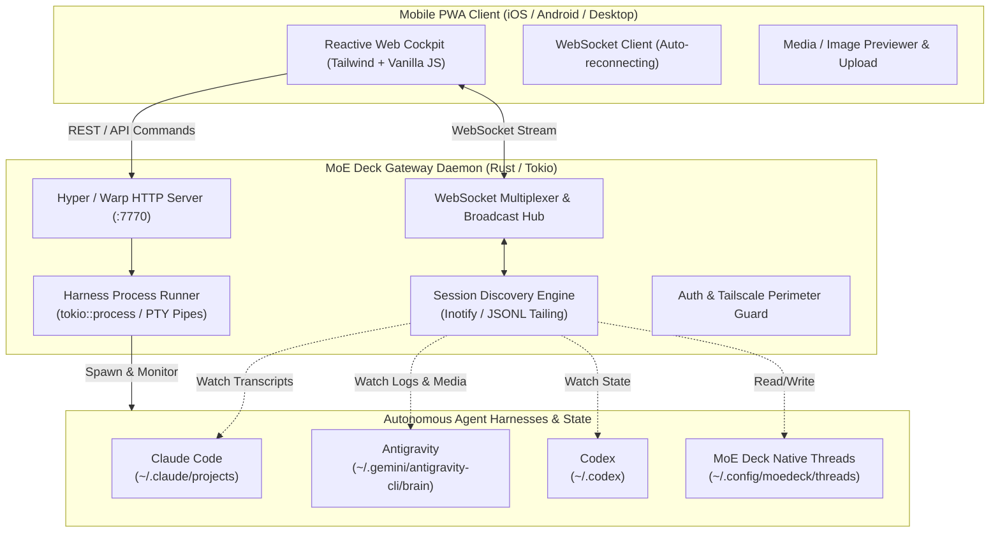

# MoE Deck Architecture & Technical Specification

MoE Deck is a lightweight, zero-overhead control daemon and mobile-first cockpit interface designed to bridge autonomous coding harnesses—including **Claude Code (`claude`)**, **Google Antigravity (`agy`)**, **Codex (`codex`)**, and **OpenCode (`opencode`)**—into a unified, real-time command surface.

---

## 1. System Overview

---

## 2. Core Architectural Principles

### 2.1 Single-Binary, Self-Contained Deployment
MoE Deck produces a single statically-linked or minimal-dependency Rust binary with zero external Node.js, Python, or Ruby runtime requirements.
- The entire web application (HTML5, PWA manifest, service worker hooks, embedded SVG icons, CSS styling, and reactive JavaScript) is embedded into the executable binary via compile-time inclusion (`ui.rs`).
- Resource footprint idles at under **5 MB of resident RAM** and near-zero CPU usage when idle.

### 2.2 Passive Discovery vs. Active Infiltration
Rather than forcing individual AI agent tools to install invasive plugins or custom adapters, MoE Deck operates primarily on an **asynchronous discovery model**:
- **Non-Invasive Journal Inspection**: Agent CLI harnesses serialize their execution state to disk (e.g., Claude Code stores project sessions under `~/.claude/projects/`, Antigravity maintains execution journals at `~/.gemini/antigravity-cli/brain/<uuid>/.system_generated/logs/transcript.jsonl`).
- **Real-Time Log Ingestion**: MoE Deck monitors these directories via filesystem watchers and file tailers, parsing incoming conversational blocks, tool execution payloads, and planner thinking traces without perturbing the host process.
- **Unified Timeline Synthesis**: Heterogeneous data formats are unified into a normalized `Message` and `Session` schema (`models.rs`) containing:
  - Agent identity and harness badge
  - Model family and inference reasoning effort
  - Structured media references (images, inline renders, diffs)
  - Execution status and timestamped audit trails

### 2.3 Sub-Second Process Execution
When dispatching commands from the mobile interface:
- MoE Deck invokes the appropriate harness CLI binary (`claude`, `agy`, `codex`) via `tokio::process::Command` with non-blocking stdout/stderr pipe multiplexing.
- Output chunks are streamed immediately across the active WebSocket connection to the client, providing character-by-character terminal responsiveness.
- Harness command flags are preserved and adapted dynamically (e.g., ensuring prompt flags `-p` correctly consume input across varying Go and Node CLI flag parsers).

---

## 3. Subsystem Breakdown

### 3.1 Session Discovery Engine (`discovery.rs`)
The discovery subsystem scans the local filesystem for past and active agent sessions:
- **Claude Code**: Discovers project directories, parses project metadata, and deserializes conversational turns from `.claude` state files.
- **Antigravity (`agy`)**: Scans `<appDataDir>/brain/` for conversation directories. Inspects `transcript.jsonl` (and full transcripts when payloads are truncated), extracting model thinking, tool calls, and assistant replies.
- **Filtering & Deduplication**: Distinguishes between top-level user sessions and internal context-handoff subagents (filtering out nested subagent conversations to keep the top-level session switcher clean).

### 3.2 Process Runner (`runner.rs`)
Responsible for executing prompts and managing harness lifecycles:
- Spawns background tasks with explicit working directory isolation.
- Captures standard output and standard error streams asynchronously, stripping VT100 control sequences when plaintext rendering is desired while retaining ANSI formatting flags for code blocks.
- Emits real-time progress events across the WebSocket broadcaster (`RunnerEvent::OutputChunk`, `RunnerEvent::Completed`, `RunnerEvent::Failed`).

### 3.3 The Reactive PWA Cockpit (`ui.rs`)
A zero-dependency, ultra-responsive web interface tailored for high-density mobile usage:
- **Multiplex panes**: One terminal-style pane per conversation, tiled on wide screens and swiped on phones. The focused pane owns `#chatScroll` and the composer; other panes poll `?tail=30` only when their conversation changed. A tmux-style window bar replaces the old Quick-Bounce strip. Harness colors:
  - **Claude Code**: Terracotta (`#D97757`)
  - **Antigravity**: Electric Blue (`#4F8FF7`)
  - **Codex**: Emerald Green (`#10A37F`)
  - **OpenCode**: Amethyst Purple (`#A855F7`)
- **Visual Render Surface**: Detects file references and image paths (e.g., `/tmp/*.png`, generated charts, 3D viewport renders) within agent output and renders them inline as interactive visual cards.
- **Mobile Input Cockpit**: Dynamic multi-line input box with safe-area inset management for iOS Safari, quick harness selector dropdown, and image attachment handling.

---

## 4. Security & Network Topology

MoE Deck is built for **Private Mesh Operations**:
1. **Network Layer**: Bind to private network interfaces (e.g., Tailscale `100.x.y.z` or `0.0.0.0` protected by Tailscale ACLs). No public internet exposure is required or recommended.
2. **Local Loopback & Token Auth**: Built-in support for bearer token authorization (`auth.rs`) and CSRF validation headers to prevent unauthorized origin requests from browser contexts.
3. **Execution Guardrails**: Runs strictly with the permissions of the host user account, ensuring agents cannot exceed the security boundaries established in the underlying OS or container sandbox.
