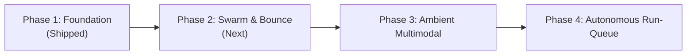

# MoE Deck Product Vision & Strategic Roadmap

> *"You shouldn't have to sit chained to a terminal window just to supervise autonomous agent swarms."*

---

## 1. The Core Philosophy

Autonomous coding agents (Claude Code, Google Antigravity, OpenAI Codex, Aider, OpenCode) have crossed the threshold from simple text completion to multi-turn reasoning and tool orchestration. They run tests, refactor codebases, create 3D renders, and execute complex workflows over minutes or hours.

Yet, the primary interface for driving them remains anchored to the 1970s terminal:
- Locked inside a local desktop `tmux` or terminal window.
- Fragile SSH sessions dropped on mobile networks.
- Zero cross-tool situational awareness (Claude doesn't know what Antigravity is doing, and Codex is in another silo).
- High cognitive tax when stepping away from the desk.

**MoE Deck transforms your phone into a sovereign command cockpit.** Whether on a walk, at the gym, commuting, or cooking dinner, you maintain ambient situational awareness, live visual inspection, and instant steering capability over your entire agent fleet.

---

## 2. Strategic Pillars

### I. Omnipresent Ambient Steering (Mobile First, Not Mobile Port)
MoE Deck is engineered from the first commit for thumb-driven mobile ergonomics:
- Native PWA experience with instant home-screen launch and zero browser chrome.
- Haptic-ready button layouts and iOS safe-area compliance.
- Inline visual render feed (inspecting 3D geometry, UI mockups, architectural diagrams directly on a high-DPI mobile screen).

### II. Harness Agnosticism (One Cockpit to Rule Them All)
Different models and harnesses excel at different tasks:
- **Claude Code**: Deep architectural reasoning, nuanced code refactoring, and complex cross-file synthesis.
- **Antigravity (`agy`)**: High-speed agentic loops, autonomous task execution, subagents, and native tool-use versatility.
- **Codex / OpenCode**: Focused script generation and specialized language tasks.

MoE Deck treats harnesses as interchangeable execution engines beneath a unified state ledger.

### III. The Cross-Harness Bounce (Agent-to-Agent Synthesis)
Why should an engineer manually copy-paste intermediate thoughts between Claude and Antigravity?
MoE Deck enables seamless context bounces:
- Run a deep architectural plan in Claude Code.
- Tap **Bounce to Antigravity** to execute the multi-step build and test loop in parallel.
- Surface results back into a single unified timeline.

---

## 3. Product Roadmap

### Phase 1: Universal Gateway Foundation *(Shipped)*
- [x] Single standalone Rust binary (`hyper`, `tokio`, minimal RAM footprint).
- [x] Passive session discovery across `~/.claude/projects` and `~/.gemini/antigravity-cli/brain`.
- [x] WebSocket live streaming of process logs and real-time execution feedback.
- [x] Quick-bounce harness bar with distinct brand visual identity.
- [x] Inline visual card rendering for local image paths (`/tmp/...png`, screenshots).
- [x] Mobile photo & screenshot upload bridge directly into agent context.
- [x] Tailscale mesh deployment for zero-config encrypted mobile access.

### Phase 2: Agent Swarm & Cross-Harness Handoff *(In Progress)*
- [ ] **Dual-Agent Co-op**: Run simultaneous Claude and Antigravity threads on the same repository with conflict-free git worktrees.
- [ ] **One-Tap Context Bounce**: Export Claude's active context window into an Antigravity prompt with full file context attached.
- [ ] **Interactive Git Diff Visualizer**: Mobile-optimized syntax-highlighted side-by-side or unified diff drawer before approving commits.
- [ ] **Permission & Tool Confirmation Stream**: Remote push approval for shell commands requiring manual human intervention (`BypassSandbox` or dangerous actions).

### Phase 3: Ambient Multimodal Interaction
- [ ] **Local Voice-to-Prompt (Whisper)**: Tap and hold microphone button on mobile to dictate instructions; local Whisper model transcribes and dispatches prompt to active harness.
- [ ] **Voice Walkie-Talkie Mode**: Audio summary of agent progress delivered over headphones during workouts or walks.
- [ ] **Camera Snap & Audit**: Snap a photo of a whiteboard, monitor, or physical sketch on mobile, instantly feeding it to the agent's multimodal vision input.

### Phase 4: Autonomous Run-Queue & Offline Resilience
- [ ] **Offline Intent Queue**: Dispatch instructions while in an elevator or subway with zero cellular connectivity; MoE Deck buffers prompts locally and executes when reconnected.
- [ ] **Proactive WebPush Notifications**: Native iOS/Android push alerts when long-running agent tasks complete or when an agent requires human decision-making.
- [ ] **Autonomous Overnight Sprints**: Schedule multi-agent test and refactoring runs with comprehensive morning debrief reports.
